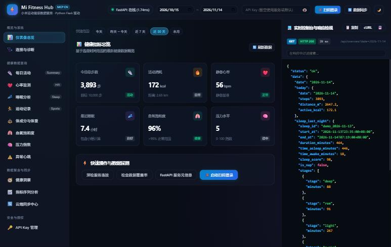
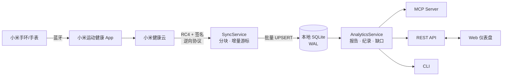

# Mi Fitness MCP CN

[](https://github.com/HUAYUE1024/mi-fitness-mcp-cn/actions/workflows/ci.yml)
[](https://www.python.org/downloads/)
[](LICENSE)
[](CHANGELOG.md)

**让 AI 读懂你的小米手环数据。** 把小米运动健康（Mi Fitness）里你自己的数据同步到本机 SQLite，再通过 **MCP / REST API / 命令行 / Web 仪表盘** 随时查询、分析、导出。数据不出本机。

> Local-first Mi Fitness (Xiaomi Band / Watch) data hub. Sync your own health data to SQLite, then ask Claude about it over MCP, or use the CLI, REST API and web dashboard.

<p align="center">
  
</p>

## 10 秒体验（不需要小米账号）

```bash
git clone https://github.com/HUAYUE1024/mi-fitness-mcp-cn.git
cd mi-fitness-mcp-cn
pip install -e '.[all]'
mi-fitness-mcp dashboard --demo      # 自动打开浏览器，里面是 90 天合成的演示数据
```

演示数据写在单独的 `demo.db`，不会碰你的真实数据。命令行同样支持 `--demo`：

```bash
mi-fitness-mcp overview --demo       # 今天的健康快照
mi-fitness-mcp report --demo         # 周报，并与上一周对比
```

```text
📅 2026-11-14 健康快照（演示数据）
==================================================
👣 步数      3,893   距离 2.65 km   活动消耗 172 kcal
😴 昨晚睡眠  7h26m   评分 98
❤️  心率      静息 56 bpm   最近 62 bpm
🫁 血氧 96%   🧠 压力 5
⚖️  体重      72.51 kg   BMI 23.4   体脂 20.4%

近 7 天：日均 7,303 步，最佳 9,313 步，7 天有数据，运动 3 次
```

## 能问 AI 什么

接入 MCP 后，直接用自然语言问 Claude（或任何支持 MCP 的客户端）：

- 「我今天状态怎么样？」→ `get_health_overview`
- 「帮我写这周的周报，和上周比有什么变化？」→ `get_period_report`
- 「我最近睡得规律吗？入睡时间波动多大？」→ `get_sleep_summary`
- 「这个月哪几天没数据？是没戴手环还是没同步？」→ `find_data_gaps`
- 「我的步数最高纪录是哪天？连续几天达标 8000 步？」→ `get_personal_records`
- 「画一下最近三个月的静息心率趋势」→ `query_metric_series`

## 功能

| | |
|---|---|
| **八类数据** | 每日活动、逐分钟心率与静息心率、睡眠（深/浅/REM/清醒分期）、运动、体重与体成分、血氧、压力、异常心跳 |
| **健康分析** | 周报/月报（自动对比上一期）、睡眠规律度、心率区间、个人纪录与连续达标、数据缺口检测 |
| **四种入口** | MCP（20 个工具）· 命令行 · REST API · Web 仪表盘 |
| **可靠同步** | 按 7 天分块、增量游标、批量事务写入、幂等；中途失败不会跳过未入库的数据 |
| **多账号隔离** | 数据按账号分库存放，API Key 绑定独立账号上下文 |
| **本地优先** | 数据与凭据只在本机（SQLite + 系统 keyring），除小米官方服务器外零第三方请求 |
| **中国区适配** | `--region cn`，同时支持 de / i2 / ru / sg / us |

> ⚠️ 非小米官方项目。云端接口为社区逆向所得，仅用于读取和分析**你自己的**健康数据，请遵守小米用户协议。接口可能因小米改版而失效。

## 安装

```bash
git clone https://github.com/HUAYUE1024/mi-fitness-mcp-cn.git
cd mi-fitness-mcp-cn
python -m venv .venv
source .venv/bin/activate      # Windows: .venv\Scripts\activate
pip install -e '.[all]'        # 全功能；只要 MCP + 命令行：pip install -e .
```

要求 Python ≥ 3.11。Linux 没有系统 keyring 时可 `pip install keyrings.alt`（会明文存储凭据，仅限无其它办法时）。

## 连接你自己的账号

**方式 A：扫码登录（推荐，无需浏览器 F12）**

```bash
mi-fitness-mcp dashboard
```

浏览器里点右上角「扫码登录」，用小米运动健康 / 米家 / 小米账号 App 扫码确认，即可自动发放 API Key。

**方式 B：手动配置 passToken**

浏览器登录 [account.xiaomi.com](https://account.xiaomi.com)，从 Cookie 取 `userId` 与 `passToken`：

```bash
mi-fitness-mcp setup           # 交互式，passToken 输入不回显
mi-fitness-mcp doctor          # 验证连通性
```

**同步数据**

```bash
mi-fitness-mcp sync --start-date 2026-01-01      # 首次：拉取历史
mi-fitness-mcp sync                              # 之后：从上次断点增量续传
mi-fitness-mcp sync --type sleep -v              # 只同步睡眠，逐块显示进度
```

## 接入 MCP（Claude Desktop 等）

```json
{
  "mcpServers": {
    "mi-fitness": { "command": "mi-fitness-mcp", "args": ["serve"] }
  }
}
```

想先试试效果？把 `args` 改成 `["serve", "--demo"]`，AI 会读到合成的演示数据。

<details>
<summary><b>20 个 MCP 工具</b></summary>

| 类别 | 工具 |
|---|---|
| 连接与同步 | `get_connection_status` · `sync_data` · `get_sync_status` · `get_profile` |
| 原始数据 | `get_daily_summary` · `query_heart_rate` · `query_sleep` · `query_workouts` · `query_body_measurements` · `query_spo2` · `query_stress` · `query_abnormal_heart_beat` · `get_data_coverage` |
| 趋势 | `query_metric_series`（14 个指标，按日/周/月聚合） |
| 分析 | `get_health_overview` · `get_period_report` · `get_sleep_summary` · `get_heart_rate_summary` · `get_personal_records` · `find_data_gaps` |

原始心率是逐分钟量级，工具说明里已提示模型优先用分析类工具，避免把几万条样本塞进上下文。

</details>

## 命令行

所有只读命令都不联网，并支持 `--json` 与 `--demo`。

| 命令 | 作用 |
|---|---|
| `status` | 本地库每类数据的记录数与覆盖范围 |
| `overview [--date]` | 某天的健康快照 |
| `report [--period week\|month]` | 周报/月报，并与上一期对比 |
| `records [--step-goal 8000]` | 历史个人纪录与连续达标天数 |
| `gaps [--type sleep]` | 找出缺数据的日期（没戴手环 / 没开监测 / 没同步） |
| `export --type sleep -o sleep.csv` | 导出 CSV（带 BOM，Excel 直接打开）或 JSON |
| `sync` · `setup` · `doctor` | 同步、配置凭据、诊断 |
| `serve` · `api` · `web` · `dashboard` | 启动 MCP、REST API、仪表盘，或一条命令全部启动 |

```text
$ mi-fitness-mcp report --demo
📊 2026-11-08 ~ 2026-11-14（7 天，演示数据）
   对比上一期 2026-11-01 ~ 2026-11-07
==================================================
总步数               51,120  (▼13.8%)
日均步数               7,303  (▼13.8%)
平均睡眠              452 分钟  (▲3.4%)
平均静息心率          56.7 bpm  (▼3.2%)
运动次数                 3 次  (＝0.0%)

😴 平均 23:23 入睡 / 07:14 起床，入睡时间波动 ±14 分钟，0 晚睡不足 6 小时
```

## REST API

```bash
mi-fitness-mcp api               # http://127.0.0.1:8321 ，交互式文档 /docs
```

| 分类 | 端点 |
|---|---|
| 原始数据 | `/api/summary` `/api/heart-rate` `/api/sleep` `/api/workouts` `/api/body-measurements` `/api/spo2` `/api/stress` `/api/abnormal-heart-beat` `/api/coverage` |
| 趋势 | `/api/metric-series?metric=resting_heart_rate&granularity=week` |
| 分析 | `/api/overview` `/api/report` `/api/sleep-summary` `/api/heart-rate-summary` `/api/records` `/api/gaps` |
| 同步与导出 | `POST /api/sync`（`background=true` 后台执行）· `GET /api/sync/{id}` · `/api/export?format=csv` |
| 鉴权 | `/api/auth/keys`（发放/列出/吊销）· `/api/auth/qr/*`（扫码登录）· `/api/status` |

```bash
curl "http://127.0.0.1:8321/api/report?start_date=2026-11-01&end_date=2026-11-07" -H "X-API-Key: mif_sk_..."
```

鉴权分层：不带 Key 时用本机 `setup` 的凭据（仅建议本机）；设置 `MI_FITNESS_API_KEY` 后所有请求必须带 `X-API-Key`；管理端点（发放/吊销 Key、扫码登录）要求 `X-Admin-Key`（`MI_FITNESS_ADMIN_KEY`），未设置时只接受 127.0.0.1 调用。

## 架构



```text
src/mi_fitness_mcp/
├── main.py              # CLI 入口
├── server.py            # MCP 工具注册表（装饰器声明，一处定义 schema 与处理函数）
├── api.py               # FastAPI：数据/分析端点、Key 体系、扫码登录
├── web.py               # Flask 仪表盘与反向代理；前端资源在 web_assets/
├── demo.py              # 合成演示数据，走真实存储链路
├── adapters/            # 小米云协议：登录、RC4、签名、分页、解析
├── services/
│   ├── sync_service.py  # 分块增量同步
│   ├── query_service.py # 读取与时间序列
│   └── analytics.py     # 周报、睡眠规律、个人纪录、缺口
└── storage/
    ├── schema.py        # 8 张表的声明式定义（DDL、写入、过滤都由它生成）
    └── __init__.py      # SQLite 读写、迁移、聚合
```

数据库与配置在系统用户目录（Linux `~/.local/share/mi-fitness-mcp/`，Windows `%LOCALAPPDATA%\mi-fitness-mcp\`），凭据在系统 keyring，都不在仓库里。从旧版本升级时，数据库会自动迁移，无需手动处理。

## 常见问题

<details>
<summary><b>心率/血氧/压力同步不到最新数据？</b></summary>

链路是「手环 → 手机 App → 小米云 → 本项目」。步数实时性最好；心率、血氧、压力的连续监测需要在小米运动健康 App 里开启（如「全天心率监测」），手环要保持佩戴。云端没有的数据本项目无法生成。可以用 `mi-fitness-mcp gaps` 看看是哪几天缺。
</details>

<details>
<summary><b>passToken 过期 / 同步报 401？</b></summary>

退出登录、改密码、在账号安全中心踢出设备都会让 passToken 失效。重新扫码登录，或重新运行 `setup`。
</details>

<details>
<summary><b>启动报错 <code>'Server' object has no attribute 'list_tools'</code>？</b></summary>

MCP SDK 2.x 移除了该 API，本项目固定 `mcp>=1.0.0,<2`。从旧版本升级后重新 `pip install -e .` 即可。
</details>

<details>
<summary><b>同步要多久？会重复入库吗？</b></summary>

首次全量按 7 天分块串行拉取，数月数据通常几分钟（逐分钟心率占大头）；之后增量同步只拉最近几天。写入是幂等 UPSERT，重复同步安全，同步结果会如实区分「新增 / 更新 / 未变」。
</details>

## 安全与隐私

**数据只进不出**：从小米云拉取你自己的数据到本地，除小米官方服务器外不与任何第三方通信，无遥测、无统计、无崩溃上报，所有查询断网可用。完整审计见 [docs/PRIVACY.md](docs/PRIVACY.md)。

- `passToken` 等同小米账号登录态，**切勿提交或泄露**；泄露后请到小米账号安全中心退出设备并重新登录
- 凭据与 API Key 密钥存系统 keyring（Windows DPAPI / macOS Keychain / Linux Secret Service）
- 数据库文件创建时权限收紧为仅当前用户可读写（类 Unix 系统）
- 服务默认只绑定 `127.0.0.1`，启用 CORS 本机限制与 Host 白名单，防恶意网页跨站读取和 DNS 重绑定。向局域网开放前务必设置 `MI_FITNESS_API_KEY` 与 `MI_FITNESS_ADMIN_KEY`
- 密钥比较使用恒定时间算法；按前缀吊销 Key 要求至少 12 位且唯一匹配
- 扫码登录端点允许扫码者把账号登录到你的服务器，务必保持管理鉴权开启

## 开发

```bash
pip install -e '.[all,dev]'
ruff check src tests     # 代码规范（CI 同款）
pytest -q                # 115 个测试，全部离线运行
python -m build
```

贡献前请看 [CONTRIBUTING.md](CONTRIBUTING.md)。`tools/probe_mifitness.py` 是协议探测脚本，用来排查小米接口变化。

## 免责声明

本项目与小米公司无关，接口为社区逆向成果，不保证持续可用。请仅用于读取和分析您自己的个人健康数据。

## License

[MIT](LICENSE) · 源自上游项目 [kubulashvili/mi-fitness-mcp](https://github.com/kubulashvili/mi-fitness-mcp)
